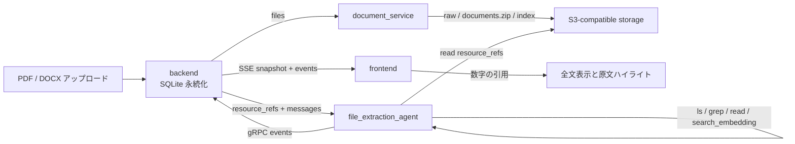

<p align="center">
  <h1 align="center">TraceAgent</h1>
  <p align="center">
    <strong>Evidence-grounded document QA - すべての回答を原文まで追跡できる。</strong>
  </p>
  <p align="center">
    <code>FastAPI</code> · <code>LangGraph</code> · <code>Next.js</code> · <code>SSE</code>
  </p>
  <p align="center">
    <a href="README.md">中文</a> · <a href="#demo">Demo</a> · <a href="#quickstart">Quick Start</a> · <a href="LICENSE">MIT License</a>
  </p>
</p>

---

> **TraceAgent は文書への回答、原文の根拠、ツールによる調査の過程をひとつのワークスペースにまとめます。**

文書の事実に関する回答には数字の引用が付き、クリックすると原文が開いて該当箇所がハイライトされます。どの資料を調べ、どこを読み、どの段落を根拠にしたかを確認できます。

<h2 id="demo">🎬 デモ</h2>

<p align="center">
  
</p>
<p align="center"><em>左：白紙全文表示とスチールブルーの引用ハイライト · 右：ツール過程、回答と数字の引用</em></p>

スクリーンショットはローカルで動作する TraceAgent 画面と架空の Orion サンプル文書です（個人情報を含みません・2026-11-25 更新）。

<table>
<tr>
<td width="50%">

<p align="center"><em>ホーム：シングルフォーカスな文書追加と質問入力</em></p>
</td>
<td width="50%">

<p align="center"><em>Dark モード：文書管理、折りたたみツール過程とニュートラル暗色チャット</em></p>
</td>
</tr>
</table>

## ✨ 主な特徴

| | 機能 | 説明 |
|---|---|---|
| 💬 | **マルチターン文書 QA** | PDF / DOCX をアップロードし、既定 36% / 64% 分割で同じ文書群に継続して質問 |
| 🔗 | **数字の引用** | Markdown ブロックへのリンクをクリック可能な数字の引用として表示 |
| 📖 | **白紙原文 Review** | 引用クリックで左側に `#FAFAFA` の白紙全文を表示し、スチールブルーで対象ブロックをハイライト（Dark モードでも紙面は白紙を維持、幅ドラッグもリセットしない） |
| 📁 | **文書管理** | ファイルごとの処理状態、再試行、追加、ダウンロードと削除 |
| 🗂️ | **会話の復元と自動タイトル** | 初回質問後にモデルが非同期でタイトルを生成し、backend の SQLite から履歴を復元 |
| 🧭 | **コンパクトな過程表示** | 連続ツール呼び出しを 1 行の折りたたみ領域に統合し、展開時は読みやすい英語アクション名で表示 |
| 🛑 | **生成キャンセル** | いつでも回答生成を中断、入力欄は編集可能なまま |
| 📄 | **複数形式** | PDF（MinerU OCR）と DOCX（python-docx）を HTML に変換し、Markdown 文書ツリーと embedding 索引を生成 |

## 🧠 仕組み



TraceAgent は文書を**読み取り専用の仮想リポジトリ**として扱います。モデルは `ls` / `grep` / `read` / `search_embedding` でディレクトリの閲覧、キーワード検索、本文の読み取り、意味の近い箇所の検索を行います。ツールの過程と回答は SSE でブラウザに逐次送信されます。

ブラウザは Next.js のプロキシを通して backend にアクセスします。backend はアップロードを検証し、独立した document service でリソースを準備してから、リソース参照とメッセージ履歴を agent に渡します。SQLite は会話、リソース参照、ターン、完全なメッセージを保存します。ページの復元時にはスナップショットを取得し、実行中のターンがあれば更新を購読します。過程の差分イベントはメモリ内で配信し、履歴のツール活動は保存済みの呼び出しと結果から復元します。

> アーキテクチャ全体は [`ARCHITECTURE.md`](ARCHITECTURE.md)、Agent の詳細は [`agent/docs/DESIGN.md`](agent/docs/DESIGN.md) を参照

<h2 id="quickstart">⚡ Quick Start</h2>

**1. 環境の作成**

```bash
conda create -n agent-gate python=3.11 -y && conda activate agent-gate
```

**2. 依存関係のインストール**

```bash
./scripts/install.sh
```

インストールには storage サービスと既定の OpenVINO embedding 依存関係を含みます。document service は起動時に embedding モデルを読み込み、ウォームアップ後に待ち受けを開始します。初回は Hugging Face からのモデルダウンロードが必要です。

公開モデルのダウンロードが 401 になり、匿名アクセスでは成功する場合、`config.toml` の `[huggingface]` で `disable_implicit_token = true`（または環境変数 `HF_HUB_DISABLE_IMPLICIT_TOKEN=1`）を設定すると、ローカルに保存された Hugging Face token の自動送信を無効にできます。非公開モデルには有効な認証情報が必要です。

**3. 設定ファイルの作成**

テンプレートからリポジトリルートに `config.toml` を作成し、モデル設定を記入します（起動スクリプトと各サービスが自動的に読み込み、同名の環境変数で上書き可能です）。

```bash
cp config.example.toml config.toml
```

主な設定例：

```toml
[model]
base_url = "https://your-model-endpoint/v1"
api_key = "your-api-key"
model = "your-model-name"
api_transport = "responses"

[document_service]
mineru_lang = "japan"

[agent]
port = 8001

[backend]
port = 8000

[frontend]
port = 3000

[storage]
port = 9000
```

**4. サービスの起動**

```bash
./scripts/start.sh
```

storage / agent / document service / backend / frontend を起動します。

ブラウザで http://127.0.0.1:3000 を開けば使えます。

1. ホーム入力欄左下のクリップボタンから PDF または DOCX を選ぶと、入力欄内のキューで順番に処理します。1 回の選択は最大 20 ファイル、合計 32 MiB。空ファイルには対応しません。
2. 処理完了後は `/tasks/{session_id}` に自動遷移します（既定で左 36% / 右 64%）。質問を送信すると回答と並行してモデルがセッションタイトルを自動生成し、トップバーと履歴ドロワーに反映します。左上の `+` からいつでも新しい会話を開始できます。
3. 回答の数字の引用をクリックすると左側の白紙リーダーに全文とハイライトを表示します（境界線をドラッグして幅を調整可能）。閉じると Sources に戻り、`+` から文書を追加できます。
4. 左上のメニューの Recent workspaces、または会話 URL から文書と履歴を復元できます。

既定のデータベースは `backend/backend.sqlite3`、ローカル storage は `storage/data` です。`config.toml` の `[backend].database_path` / `[storage].data_root`（または同名環境変数）で変更できます。`[storage].endpoint_url`（または `S3_ENDPOINT_URL`）を設定すると外部 S3 互換サービスを利用し、ローカル storage の起動を省略します。終了時はスクリプトが起動したサービスを停止します。

現在は単一ユーザー向けのローカル構成です。backend は単一プロセスで動作し、テナント認証や旧 `qa_*` データの自動移行はありません。

> 詳細な設定と設計：[`agent/`](agent/README.md) · [`document_service/`](document_service/README.md) · [`backend/`](backend/README.md) · [`frontend/`](frontend/docs/DESIGN.md)

## 🗺️ プロジェクト構成

```
agent_proto/      共有 protobuf/gRPC 契約
document_service/ 文書解析、Markdown 文書ツリー、embedding とリソース公開
storage/          ローカル S3 互換 HTTP サービス
shared/           object store クライアントと config.toml 設定ローダー
agent/            QA Agent（LangGraph）
backend/          SQLite：sessions / resources / turns / messages
frontend/         文書管理、QA、ツールの過程と全文表示（Next.js）
```

## 📄 ライセンス

[MIT](LICENSE)
