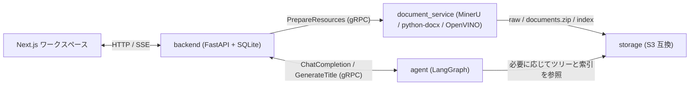

<div align="center">

# TraceAgent

**文書 QA のすべての結論を、ワンクリックで原文へ。**

PDF / DOCX に対応したローカル文書 QA ワークスペース。段落単位の引用ハイライト、確認できる調査ステップ、ダークモードでも白紙で読める原文ビューを備えています。

[中文](README.md) · [クイックスタート](#クイックスタート) · [アーキテクチャ](ARCHITECTURE.md) · [MIT License](LICENSE)

</div>


## なぜ TraceAgent か

LLM に長い文書を読ませたとき、いちばん時間がかかるのは質問ではなく裏取りです。その記述はどのページにあるのか、文脈を切り取っていないか、他の添付ファイルも見ているのか。

TraceAgent は「質問」と「検証」をひとつの分割画面にまとめました。

- **番号付き引用をクリックして、そのまま原文の該当箇所へ**。左側に全文と前後の文脈を保ったまま対象段落をハイライトします。ダークモードでも原文エリアは白背景・黒文字を維持し、長時間でも読みやすくしています。
- **断片を詰め込むのではなく、人のように文書をたどる**。PDF と DOCX を構造化された文書ツリーとベクトル索引に変換し、モデルが必要に応じて一覧確認・キーワード検索・意味検索・本文読み取りを行います。調査の履歴は回答上部に折りたたまれ、いつでも展開して検証できます。
- **そのまま使えるローカルのマルチターン環境**。追加質問、ファイルの追加・削除、生成の途中キャンセル、セッションタイトルの自動生成に対応。履歴と索引はローカルの SQLite とオブジェクトストレージに残り、リロードしても続きから再開できます。

<table>
  <tr>
    <td width="50%">
      
      <p align="center">シンプルなホーム画面：PDF / DOCX を選んでそのまま質問</p>
    </td>
    <td width="50%">
      
      <p align="center">ダークモード：ファイル管理と折りたたまれた調査ステップ</p>
    </td>
  </tr>
</table>

## クイックスタート

必要な環境：Python 3.11、pnpm。

```bash
# 1. 環境作成とインストール（Python パッケージ + フロントエンドビルド）
conda create -n agent-gate python=3.11 -y && conda activate agent-gate
./scripts/install.sh

# 2. 設定テンプレートをコピーしてモデル情報を記入
cp config.example.toml config.toml
```

`config.toml` に任意の OpenAI 互換エンドポイントを設定します（`api_transport` は `responses` または `chat_completions`）：

```toml
[model]
base_url = "https://your-model-endpoint/v1"
api_key = "your-api-key"
model = "your-model-name"
api_transport = "responses"
```

全サービスを起動して http://127.0.0.1:3000 を開きます：

```bash
./scripts/start.sh
```

ローカルのオブジェクトストレージ、文書処理、Agent、バックエンド、フロントエンドがまとめて起動し、`Ctrl+C` で一括停止します。

<details>
<summary>主な設定と初回起動の補足（タイトル用モデル・PDF 言語・外部 S3・HF 401）</summary>

- **タイトル生成用モデル**：`config.toml` の `[title_model]` を設定すると、軽量な別モデルでセッションタイトルを非同期生成できます。未設定時は `[model]` を共用します。各項目は同名の環境変数でも上書き可能です。
- **初回起動時の embedding モデル取得**：`document_service` は起動時に Hugging Face から OpenVINO 用 embedding モデルを取得しウォームアップします。ローカルに残った HF token で公開モデルが 401 になる場合は `[huggingface].disable_implicit_token = true` を設定してください。
- **PDF の解析言語**：PDF は MinerU で解析します。言語は `[document_service].mineru_lang` で変更できます。
- **ストレージと DB**：オブジェクトストレージは既定でローカルの `storage/data` に保存されます。既存の MinIO や S3 を使う場合は `[storage].endpoint_url` を指定してください。会話履歴は `backend/backend.sqlite3` に保存されます（単一ユーザーのローカル利用向け・認証なし）。

</details>

## アーキテクチャ概要

文書解析、探索 Agent、永続化、UI を独立サービスに分け、gRPC 契約とオブジェクトストレージで疎結合につないでいます。



```text
agent_proto/       共有 protobuf / gRPC 契約
storage/           ローカル S3 互換オブジェクトストレージ
shared/            オブジェクトストレージクライアントと config.toml ローダー
document_service/  PDF / DOCX 解析、Markdown ツリーとベクトル索引の構築
agent/             LangGraph ベースの文書 QA・タイトル生成サービス
backend/           セッション管理、SQLite 永続化と SSE ストリーミング
frontend/          Next.js デュアルテーマ閲覧・QA ワークスペース
```

詳細ドキュメント：[全体アーキテクチャ](ARCHITECTURE.md) · [Agent](agent/README.md) · [文書サービス](document_service/README.md) · [バックエンド](backend/README.md) · [フロントエンド設計](frontend/docs/DESIGN.md)

## License

[MIT](LICENSE)
