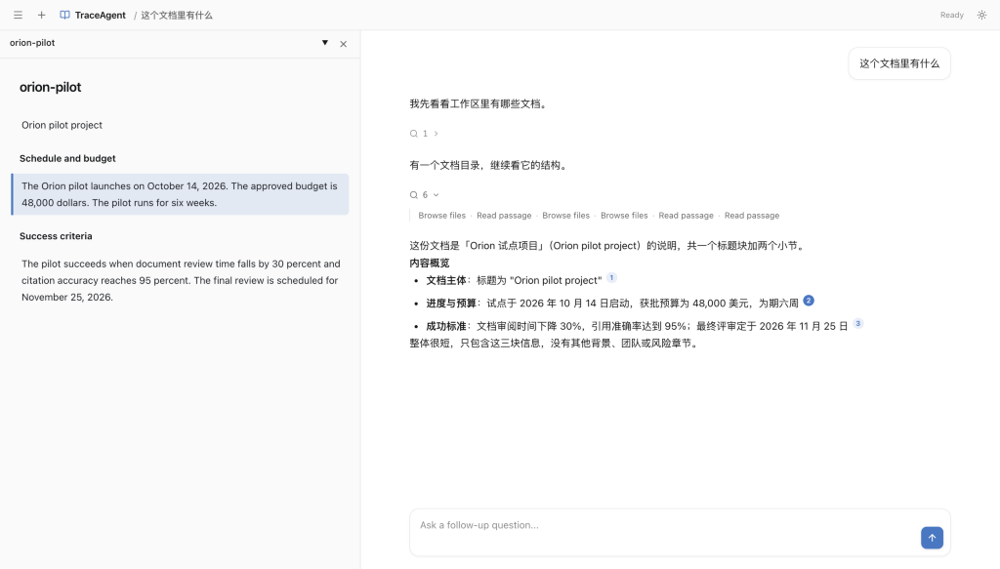
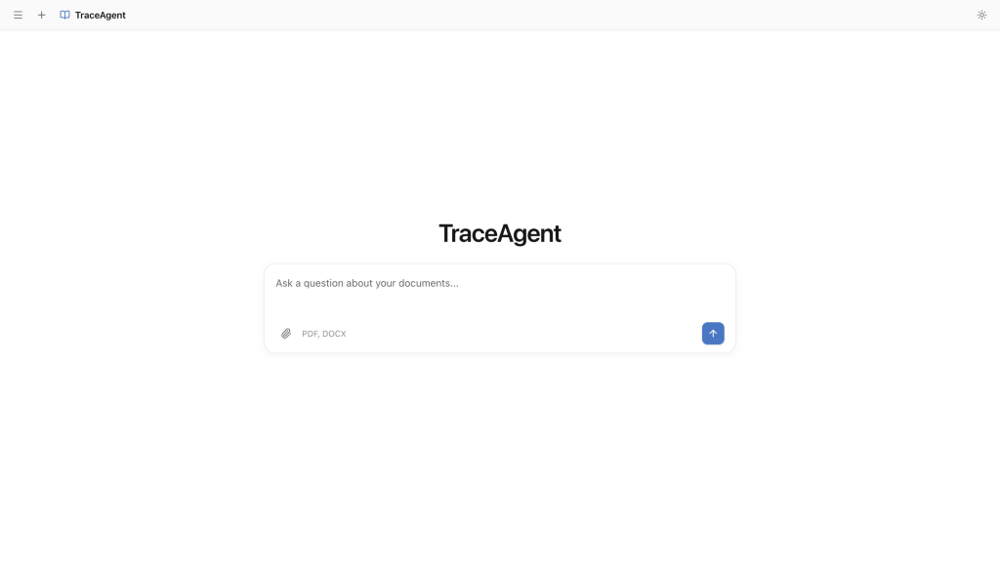

# TraceAgent

[中文](README.md)

ローカルで動く文書 QA ワークスペースです。PDF や DOCX をアップロードすると、モデルが目次をたどり本文を検索して、番号付きの引用を添えて回答します。引用をクリックすると、左側に原文が開いて該当箇所がハイライトされます。



## できること

- 回答内の番号付き引用は文書中の具体的な段落に紐づいています。クリックすると左側に全文が開き、該当箇所へスクロールしてハイライトします。ダークモードでも原文エリアは白背景のまま保ち、読みやすさを維持します。
- モデルがどのファイルを開き、何を探したかは回答上部の折りたたみ欄にまとまります。必要なときだけ開いて確認でき、生成中でもいつでも中断できます。
- 同じセッションで追加質問やファイルの追加・ダウンロード・削除ができます。履歴と文書インデックスはローカルの SQLite とオブジェクトストレージに保存されるため、リロードしても続きから再開できます。

ホーム画面とダークモード：




## クイックスタート

Python 3.11 と pnpm が必要です。

1. 環境を作って依存関係をインストールします（Python パッケージとフロントエンドのビルドを含みます）：

```bash
conda create -n agent-gate python=3.11 -y
conda activate agent-gate
./scripts/install.sh
```

2. テンプレートから `config.toml` を作成し、モデルの接続先と API キーを記入します：

```bash
cp config.example.toml config.toml
```

最小構成では `[model]` だけ設定すれば動きます（OpenAI 互換 API に対応、`api_transport` は `responses` または `chat_completions`）：

```toml
[model]
base_url = "https://your-model-endpoint/v1"
api_key = "your-api-key"
model = "your-model-name"
api_transport = "responses"
```

セッションタイトルの自動生成に別の軽量モデルを使いたい場合は `[title_model]` に記入します。空のままにすると `[model]` の設定をそのまま使います。各項目は同名の環境変数でも上書きできます。

3. サービスを起動します：

```bash
./scripts/start.sh
```

起動したら http://127.0.0.1:3000 を開きます。ローカルのオブジェクトストレージ、文書処理、Agent、バックエンド、フロントエンドがまとめて起動し、`Ctrl+C` で一括停止します。

### 補足

- 初回起動時、`document_service` は Hugging Face から OpenVINO 用の embedding モデルを取得してウォームアップします。ローカルに残っている HF token が原因で公開モデルの取得が 401 になる場合は、`config.toml` の `[huggingface]` で `disable_implicit_token = true` を設定してください。
- PDF は MinerU で解析します。対象言語は `[document_service].mineru_lang` で変更できます。
- オブジェクトストレージは既定でローカルの `storage/data` を使います。既存の MinIO や S3 を使う場合は `[storage].endpoint_url` を指定してください。会話履歴は `backend/backend.sqlite3` に保存されます。単一ユーザーのローカル利用を前提としており、認証機能はありません。

## 仕組みと構成

アップロードされた PDF（MinerU）と DOCX（python-docx）は `document_service` で HTML、Markdown の文書ツリー、embedding インデックスに変換され、オブジェクトストレージに保存されます。質問を受けると `agent` がそのツリーを読み取り専用のフォルダのように探索し（一覧取得・キーワード検索・本文読み取り・意味検索）、ストリーミング結果を `backend` 経由で保存しながらフロントエンドへ送ります。

```text
agent_proto/       gRPC / protobuf 定義
storage/           ローカル S3 互換オブジェクトストレージ
shared/            オブジェクトストレージクライアントと config.toml ローダー
document_service/  PDF / DOCX 解析、Markdown ツリーと embedding 構築
agent/             LangGraph ベースの文書 QA Agent
backend/           FastAPI + SQLite によるセッション管理・永続化・SSE 配信
frontend/          Next.js ワークスペース UI
```

アーキテクチャ全体は [ARCHITECTURE.md](ARCHITECTURE.md)、各パッケージの詳細は [agent](agent/README.md)・[document_service](document_service/README.md)・[backend](backend/README.md)・[frontend/docs/DESIGN.md](frontend/docs/DESIGN.md) を参照してください。

## License

[MIT](LICENSE)
