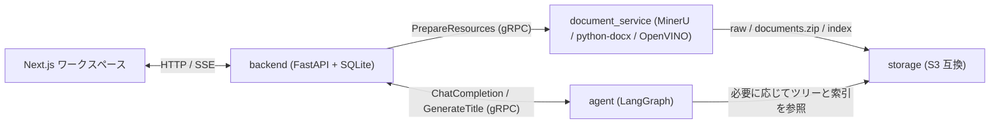

<div align="center">

# TraceAgent

**Evidence-grounded Document QA**

PDF / DOCX に対応したローカル文書 QA ワークスペース。段落単位の引用ハイライト、確認できる検索ステップ、ダークモードでも白紙で読める原文ビューを備えています。

[中文](README.md) · [クイックスタート](#クイックスタート) · [アーキテクチャ](#アーキテクチャ) · [MIT License](LICENSE)

</div>


## 特徴

- **段落単位の引用トレース**：回答内の番号付き引用をクリックすると、左側に全文を開いて対象段落をハイライトします。ダークモードでも原文エリアは白背景・黒文字を維持します。
- **構造化文書探索**：PDF（MinerU）と DOCX（python-docx）を Markdown 文書ツリーと OpenVINO ベクトル索引に変換します。Agent が必要に応じて一覧取得・キーワード検索・意味検索・本文読み取りを行い、手順は回答上部に折りたたんでいつでも展開できます。
- **ローカル永続ワークスペース**：マルチターン質問、文書の追加・削除、生成中のキャンセル、セッションタイトルの自動生成に対応。履歴と索引はローカルの SQLite と S3 互換オブジェクトストレージに保存され、リロード後も復元できます。

<table>
  <tr>
    <td width="50%">
      
      <p align="center">ホーム画面と文書アップロード</p>
    </td>
    <td width="50%">
      
      <p align="center">ダークモードとファイル管理</p>
    </td>
  </tr>
</table>

## クイックスタート

必要な環境：Python 3.11、pnpm。

```bash
# 1. 環境作成とインストール（Python パッケージ + フロントエンドビルド）
conda create -n agent-gate python=3.11 -y && conda activate agent-gate
./scripts/install.sh

# 2. 設定テンプレートをコピーしてモデル情報を記入
cp config.example.toml config.toml
```

`config.toml` に任意の OpenAI 互換エンドポイントを設定します（`api_transport` は `responses` または `chat_completions`）：

```toml
[model]
base_url = "https://your-model-endpoint/v1"
api_key = "your-api-key"
model = "your-model-name"
api_transport = "responses"
```

全サービスを起動して http://127.0.0.1:3000 を開きます：

```bash
./scripts/start.sh
```

ローカルのオブジェクトストレージ、文書サービス、Agent、バックエンド、フロントエンドが一括起動し、`Ctrl+C` で停止します。

<details>
<summary>主な設定と初回起動の補足（タイトル用モデル・PDF 言語・外部 S3・HF 401）</summary>

- **タイトル生成用モデル**：`config.toml` の `[title_model]` を設定すると、軽量な別モデルでセッションタイトルを非同期生成できます。未設定時は `[model]` を共用します。各項目は同名の環境変数でも上書き可能です。
- **初回起動時の embedding モデル取得**：`document_service` は起動時に Hugging Face から OpenVINO 用 embedding モデルを取得しウォームアップします。ローカルに残った HF token で公開モデルが 401 になる場合は `[huggingface].disable_implicit_token = true` を設定してください。
- **PDF の解析言語**：PDF は MinerU で解析します。言語は `[document_service].mineru_lang` で変更できます。
- **ストレージと DB**：オブジェクトストレージは既定でローカルの `storage/data` に保存されます。既存の MinIO や S3 を使う場合は `[storage].endpoint_url` を指定してください。会話履歴は `backend/backend.sqlite3` に保存されます（単一ユーザーのローカル利用向け・認証なし）。

</details>

## アーキテクチャ



```text
agent_proto/       共有 protobuf / gRPC 契約
storage/           ローカル S3 互換オブジェクトストレージ
shared/            オブジェクトストレージクライアントと config.toml ローダー
document_service/  PDF / DOCX 解析、Markdown ツリーとベクトル索引の構築
agent/             LangGraph ベースの文書 QA・タイトル生成サービス
backend/           セッション管理、SQLite 永続化と SSE ストリーミング
frontend/          Next.js デュアルテーマ閲覧・QA ワークスペース
```

詳細ドキュメント：[ARCHITECTURE.md](ARCHITECTURE.md) · [agent](agent/README.md) · [document_service](document_service/README.md) · [backend](backend/README.md) · [frontend](frontend/docs/DESIGN.md)

## License

[MIT](LICENSE)
