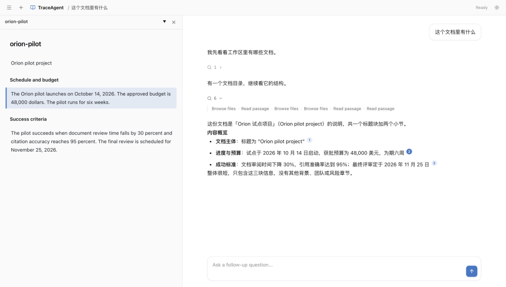
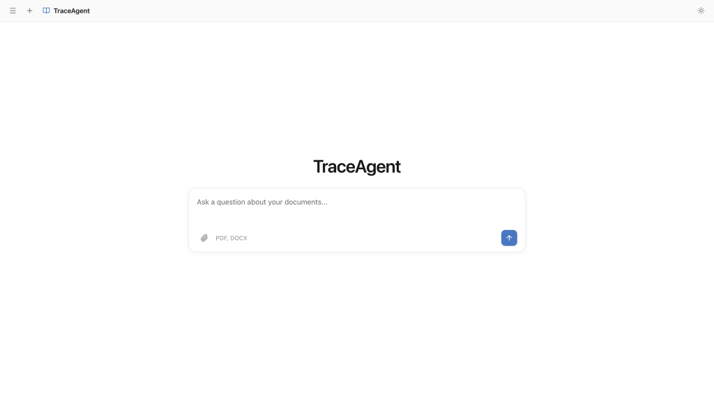
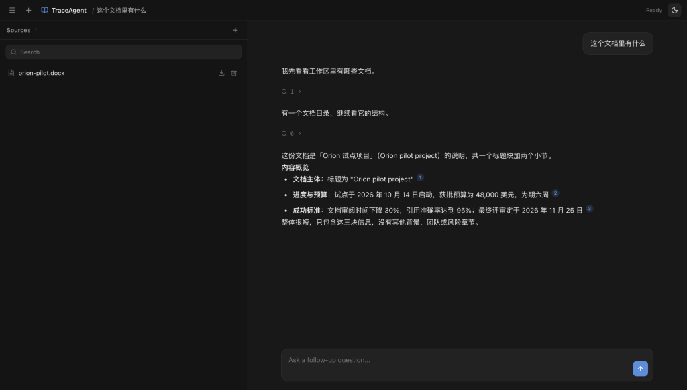

# TraceAgent

[日本語](README.ja.md)

本地运行的文档问答工作台。上传 PDF 或 DOCX 后，模型一边翻目录、搜正文、读片段，一边给出带数字引用的回答；点任意引用，左侧会直接打开原文并定位到对应段落。



## 用起来是什么样

- 回答里的每个数字引用都对应文档中的具体段落，点击会在左侧展开原文并高亮。切到深色模式时，原文阅读区依然保持白底黑字，长时间看文档不费眼。
- 模型翻目录、搜正文、读片段的过程收在回答上方的折叠栏里，想核对时点开看，平时不干扰阅读；生成中随时可以取消。
- 同一个会话里可以继续追问、补传、下载或删除文件。会话历史和文档索引保存在本地 SQLite 和对象存储里，刷新页面或下次打开还能接着聊。

首页上传入口与深色模式：





## 快速开始

需要 Python 3.11 和 pnpm。

1. 创建环境并安装依赖（包含 Python 依赖与前端构建）：

```bash
conda create -n agent-gate python=3.11 -y
conda activate agent-gate
./scripts/install.sh
```

2. 从模板生成配置文件并填入你的模型地址、Key 和模型名：

```bash
cp config.example.toml config.toml
```

最简配置只需要改 `config.toml` 的 `[model]` 段（支持 OpenAI 兼容接口，`api_transport` 可选 `responses` 或 `chat_completions`）：

```toml
[model]
base_url = "https://your-model-endpoint/v1"
api_key = "your-api-key"
model = "your-model-name"
api_transport = "responses"
```

如果想用另一个更轻量的模型生成会话标题，可以单独填写 `[title_model]`，留空则自动复用 `[model]`。所有配置项也都可以用同名环境变量覆盖。

3. 启动全部服务：

```bash
./scripts/start.sh
```

启动后打开 http://127.0.0.1:3000。脚本会一并拉起本地对象存储、文档服务、Agent、后端和前端，按 `Ctrl+C` 会全部停止。

### 几个实用说明

- 首次启动时，`document_service` 会从 Hugging Face 下载并预热 OpenVINO embedding 模型，预热完成后才开始提供服务。如果本机留有旧的 HF token 导致拉公开模型报 401，把 `config.toml` 里 `[huggingface]` 下的 `disable_implicit_token` 改成 `true`。
- PDF 默认用 MinerU 解析，识别语言可在 `[document_service].mineru_lang` 里改。
- 对象存储默认起在本地 `storage/data`，已有 MinIO 或其他 S3 服务的话，在 `[storage].endpoint_url` 填地址即可直接复用。会话默认存在 `backend/backend.sqlite3`，面向单人本地使用，没有登录鉴权。

## 工作方式与目录

上传的 PDF（MinerU）和 DOCX（python-docx）会先由 `document_service` 转成 HTML、Markdown 目录树和向量索引，存到对象存储里。提问时，`agent` 把这些文件当成只读目录来查（列目录、关键词搜索、读片段、语义检索），流式结果经 `backend` 落库后推给前端展示。

```text
agent_proto/       gRPC / protobuf 协议定义
storage/           本地 S3 兼容对象存储
shared/            对象存储客户端与 config.toml 读取
document_service/  PDF / DOCX 解析、Markdown 树与向量索引构建
agent/             基于 LangGraph 的文档问答 Agent
backend/           FastAPI + SQLite 会话编排、持久化和 SSE 推送
frontend/          Next.js 工作台界面
```

更多架构与开发说明见 [ARCHITECTURE.md](ARCHITECTURE.md)，各模块细节见 [agent](agent/README.md)、[document_service](document_service/README.md)、[backend](backend/README.md) 与 [frontend/docs/DESIGN.md](frontend/docs/DESIGN.md)。

## License

[MIT](LICENSE)
