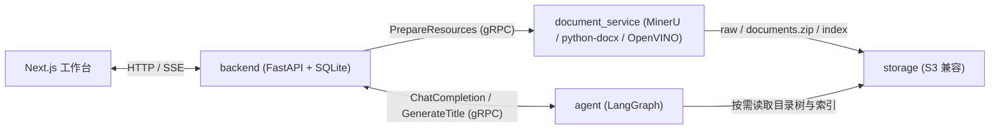

<div align="center">

# TraceAgent

**Evidence-grounded Document QA**

把 PDF / DOCX 解析为 Agent 可主动浏览的文档树，让每句结论都能一键高亮回到原文段落。

[日本語](README.ja.md) · [快速开始](#快速开始) · [架构](#架构) · [MIT License](LICENSE)

</div>


## 核心差异

| 维度 | 常见切片 RAG | TraceAgent |
| --- | --- | --- |
| **检索方式** | 固定分块，一次性 Top-K 注入上下文 | 解析为 Markdown 目录树与向量索引，Agent 按需 `ls` / `grep` / `read` / 语义检索 |
| **引用核对** | 仅附文件名或页码，需手动翻找原文 | 点击数字引用，左侧直接展开全文并定位高亮目标段落 |
| **长文阅读** | 碎片化摘录或纯文本对话框 | 分栏保留完整上下文，深色模式下原文纸面保持白底黑字 |
| **过程与控制** | 黑盒输出最终结论 | 查阅步骤折叠在回答上方可随时展开，支持中途取消、多轮补传与 SQLite 恢复 |

<table>
  <tr>
    <td width="50%">
      
      <p align="center">首页上传与提问</p>
    </td>
    <td width="50%">
      
      <p align="center">深色模式与来源管理</p>
    </td>
  </tr>
</table>

## 快速开始

环境要求：Python 3.11、pnpm。

```bash
# 1. 创建环境并安装依赖（Python 包 + 前端构建）
conda create -n agent-gate python=3.11 -y && conda activate agent-gate
./scripts/install.sh

# 2. 复制配置模板，在 config.toml 中填入模型信息
cp config.example.toml config.toml
```

在 `config.toml` 中配置任意 OpenAI 兼容接口（`api_transport` 支持 `responses` 或 `chat_completions`）：

```toml
[model]
base_url = "https://your-model-endpoint/v1"
api_key = "your-api-key"
model = "your-model-name"
api_transport = "responses"
```

启动全部服务后访问 http://127.0.0.1:3000：

```bash
./scripts/start.sh
```

脚本会同时启动本地对象存储、文档服务、Agent、后端和前端，按 `Ctrl+C` 一键停止。

<details>
<summary>常用配置与首次启动说明（标题模型、PDF 语言、外部 S3、HF 401）</summary>

- **独立标题模型**：在 `config.toml` 中配置 `[title_model]` 可用更轻量的模型异步生成会话标题，留空默认复用 `[model]`；所有配置项也支持同名环境变量覆盖。
- **首次启动下载 embedding 模型**：`document_service` 启动时会从 Hugging Face 加载并预热 OpenVINO embedding 模型。若本机残留旧 HF token 导致拉公开模型报 401，将 `[huggingface].disable_implicit_token` 设为 `true`。
- **PDF 识别语言**：PDF 使用 MinerU 解析，可在 `[document_service].mineru_lang` 中调整语言。
- **对象存储与数据库**：对象存储默认落盘在本地 `storage/data`，已有 MinIO 或 S3 服务时填写 `[storage].endpoint_url` 即可复用。会话默认存在 `backend/backend.sqlite3`（面向单人本地使用，无登录鉴权）。

</details>

## 架构



```text
agent_proto/       共享 protobuf / gRPC 契约
storage/           本地 S3 兼容对象存储
shared/            对象存储客户端与 config.toml 配置加载
document_service/  PDF / DOCX 解析、Markdown 目录树与向量索引构建
agent/             基于 LangGraph 的文档问答与标题生成服务
backend/           会话编排、SQLite 持久化与 SSE 流式推送
frontend/          Next.js 双主题阅读与问答工作台
```

详细文档：[ARCHITECTURE.md](ARCHITECTURE.md) · [agent](agent/README.md) · [document_service](document_service/README.md) · [backend](backend/README.md) · [frontend](frontend/docs/DESIGN.md)

## License

[MIT](LICENSE)
