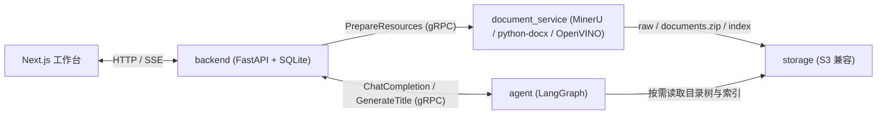

<div align="center">

# TraceAgent

**让文档问答的每一句结论，都能点回原文。**

本地运行的 PDF / DOCX 文档问答工作台，支持段落级引用定位、可核对的工具查阅轨迹与深色模式白纸阅读。

[日本語](README.ja.md) · [快速开始](#快速开始) · [架构设计](ARCHITECTURE.md) · [MIT License](LICENSE)

</div>


## 为什么做 TraceAgent

用大模型读长文档时，最耗时间的往往不是提问，而是核对答案：这句话出自哪一页、上下文有没有断章取义、模型到底有没有翻过附件里的其他文件。

TraceAgent 把「问答」和「查证」放进同一个分栏界面：

- **点开数字引用，直接落到原文那一段**。左侧保留完整上下文并高亮目标段落，不把文档切碎成孤立片段；切到深色模式时，原文纸面依然保持白底黑字，像在暗处摊开一页纸。
- **像人一样翻文档，而不是盲塞切片**。上传的 PDF 和 DOCX 会整理成带目录结构的文档树与向量索引，模型按需列目录、搜关键词、语义检索、读片段；查阅轨迹收在回答上方，点开就能复查每一步。
- **完整的本地多轮工作台**。支持连续追问、补传和删除文件、中途取消生成、自动总结会话标题，刷新或换标签页都能从本地 SQLite 恢复完整历史。

<table>
  <tr>
    <td width="50%">
      
      <p align="center">极简首页：选择 PDF / DOCX 即可开问</p>
    </td>
    <td width="50%">
      
      <p align="center">深色模式：来源管理与可折叠查阅轨迹</p>
    </td>
  </tr>
</table>

## 快速开始

环境要求：Python 3.11、pnpm。

```bash
# 1. 创建环境并安装依赖（Python 包 + 前端构建）
conda create -n agent-gate python=3.11 -y && conda activate agent-gate
./scripts/install.sh

# 2. 复制配置模板，在 config.toml 中填入模型信息
cp config.example.toml config.toml
```

打开 `config.toml`，填入任意 OpenAI 兼容接口（`api_transport` 支持 `responses` 或 `chat_completions`）：

```toml
[model]
base_url = "https://your-model-endpoint/v1"
api_key = "your-api-key"
model = "your-model-name"
api_transport = "responses"
```

启动全部服务并打开 http://127.0.0.1:3000：

```bash
./scripts/start.sh
```

脚本会一起拉起本地对象存储、文档处理、Agent、后端和前端，按 `Ctrl+C` 一键停止。

<details>
<summary>常用配置与首次启动说明（标题模型、PDF 语言、外部 S3、HF 401）</summary>

- **独立标题模型**：在 `config.toml` 中配置 `[title_model]` 可用更轻量的模型异步生成会话标题，留空默认复用 `[model]`；所有配置项也支持同名环境变量覆盖。
- **首次启动下载 embedding 模型**：`document_service` 启动时会从 Hugging Face 加载并预热 OpenVINO embedding 模型。若本机残留旧 HF token 导致拉公开模型报 401，将 `[huggingface].disable_implicit_token` 设为 `true`。
- **PDF 识别语言**：PDF 使用 MinerU 解析，可在 `[document_service].mineru_lang` 中调整语言。
- **对象存储与数据库**：对象存储默认落盘在本地 `storage/data`，已有 MinIO 或 S3 服务时填写 `[storage].endpoint_url` 即可复用。会话默认存在 `backend/backend.sqlite3`（面向单人本地使用，无登录鉴权）。

</details>

## 架构一览

TraceAgent 将解析、检索、持久化与界面拆成独立服务，通过 gRPC 契约与对象存储解耦：



```text
agent_proto/       共享 protobuf / gRPC 契约
storage/           本地 S3 兼容对象存储
shared/            对象存储客户端与 config.toml 配置加载
document_service/  PDF / DOCX 解析、Markdown 目录树与向量索引构建
agent/             基于 LangGraph 的文档问答与标题生成服务
backend/           会话编排、SQLite 持久化与 SSE 流式推送
frontend/          Next.js 双主题阅读与问答工作台
```

深入了解：[顶层架构](ARCHITECTURE.md) · [Agent](agent/README.md) · [文档服务](document_service/README.md) · [后端](backend/README.md) · [前端设计](frontend/docs/DESIGN.md)

## License

[MIT](LICENSE)
